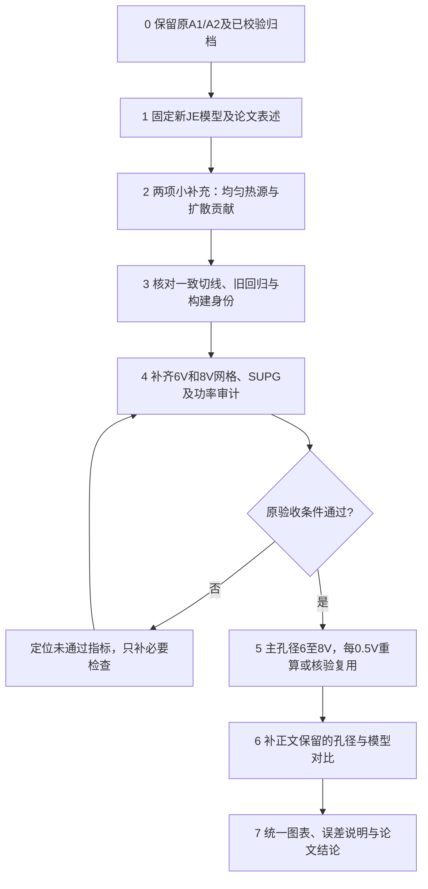

# 更换焦耳热后的最小论文补充流程

日期：2026-10-18。状态：工作范围与流程已确定，本文不构成新的求解或验收证书。

依据用户最新要求：原A1、A2不变；以小改动、尽快完成论文为目标，先确定补充算例与步骤。本说明取代此前将A2P、一维全场新解析解、全场制造解列为当前必做任务的安排。原归档、协议、已通过记录及FAIL记录全部保留。

## 范围与原则

- 保留原A1、A2及其验证含义，不扩大它们的适用范围。A1是零电流的线性化联合解析基准；A2检验等温带孔电势/电场集中与相应边界，不能作为温升、热应力或非零扩散热的验证。
- 新生产分支明确启用 `heat_source_current_work=.true.`，采用有符号 `Q=E·(Jn+Jp)`，R=0。原漂移热源默认路径保留。
- 这是简化电流做功热模型，不宣称完整热电闭合，也不宣称更换热源已解决高Pe离散问题。
- 不修改生产热源来凑平功率，不截断负热源，不以SUPG补偿项增加热源，不放宽原验收阈值。
- 不开展A2P后续扩展、全场制造解、新的压电/热释电/复合/高场迁移率开发。已有A2P诊断归为独立探索记录，仍为未通过；不能改写为PASS。
- 本轮只制定流程，不启动原生求解，不修改线性求解器或物理核心。

## 顺序总览

## 第0步：保存旧工作，明确可复用范围（已完成）

原输入、源码/构建、数据和图件分别归档在项目根目录 `solver_backups/HEAT_MIGRATION_20261018/`。
10,005个ZIP成员已逐一SHA-256回读校验，原件留在原处。原A1/A2图与数据继续保留。

旧漂移热源生产结果可以作为历史对照，不能改名为新JE结果。原JE结果只有在模型、输入、网格、可执行文件、输出哈希及对应验收范围匹配时才可复用；仅有Newton收敛不能升级为网格通过。

交付：保存清单与来源索引。无须重新制作全部旧图，也不重复无变化的解析计算。

## 第1步：固定新模型和论文措辞（文档小改动）

写清以下两式：

`Q_drift = E·(Jn_drift+Jp_drift)`

`Q_JE = E·(Jn+Jp) = Q_drift + E·(Jn_diff+Jp_diff)`

列明原有材料、输运、边界、R=0和热流定义，解释热源变化会改变稳态热反馈。保留旧默认开关，新输入显式选JE。

交付：论文模型段、热源定义与分支标签。完成条件：公式、代码、输入、图注四者一致；不使用“完整热力学闭合”或“已经解决高Pe”的超范围表述。

## 第2步：只保留两个必要补充解析验证（已有实现及通过记录）

### 补充S1：均匀焦耳热 A1JJE

目的：确认新热源从本构进入热方程，再传递到温度与边界热流的整个路径正确。

采用冻结输运、均匀浓度、线性电势、两端定温的杆。常数热源为Q0时，解析温升为 `theta(x)=Q0*x*(L-x)/(2*k)`。
核查电势、温度、实际材料热源、体积分与独立边界热流；保留反向电压、零电压、关热源、横向网格和不同初值控制。

已有13个内部求解子例通过。正文用一幅温度解析/FEM对照与一张误差/能量表即可，完整子例记录放补充材料。它不能区分无扩散情况下的两种热源定义，必须与S2配套。

### 补充S2：非零扩散贡献 JEGRAD

目的：直接验证新旧热源差异中的 `E·J_diff`，包括符号与温度切线。

使用冻结线性输运、相同电子/空穴相对浓度梯度、不同迁移率的现有精确解。梯度取负、零、正三种，保持中性电荷；完整电流和JE为已知常数，温度仍有闭式解。
核查Jn/Jp、JE、独立漂移/扩散分解、温度、端口功率和外边界热流。原漂移热源及人为温度扰动作为负对照，确认审计确实会拒绝错误结果。

已有10个全局求解子例及非线性局部抵消/解析切线检查通过。正文可用三种梯度下的热源或峰温对照小图，详细误差放补充材料。

S1/S2均复用真实生产本构/装配/求解通路。旧独立通量审计的LQ辅助diffusion_work分解存在参考浓度口径问题；使用JEGRAD已有独立正确分解，不以该辅助字段认证LQ扩散热。总JE与总通量的口径另行核验。

完成条件：核对原通过记录的源码/构建身份，继续沿用各自冻结门限；有实质源码变化时才定向重跑。不得将S1/S2改称完整三维全耦合解析验证。

## 第3步：一致切线、原回归和版本身份（不增加物理算例）

核对已有 G02JE、F1MJE、G04JE 和 SUPG/SUPGJ/SUPGJT，覆盖本构、装配及稳定化相关导数；保留A1/A2回归和16项旧CLI逐字节对照。
首次完整运行中，16项旧CLI通过且逐字节一致，11项专项中10项通过，唯一失败为独立A2P扩展。原整体FAIL记录保持不变。

本次用户删除A2扩展需求后，应另建“论文JE所需验证范围”的证据清单。不能覆盖旧acceptance结果，不能自动把旧11项运行改成全部通过。新清单必须链接各项实际PASS、所用构建、源哈希及限制。

现有网格入口要求旧11项整体acceptance；未来执行前需要显式适配新的论文范围清单，仍严格验证全部相关热源/切线/回归检查、物理源码、构建身份与原网格门限，不能简单删除gate条件。该入口适配尚未实施。

交付：一页验证证据索引。原A1/A2和没有变化的代码不重复整套开发；必要的小脚本变更只处理身份、分支标签与证据连接。

## 第4步：补齐6V、8V网格与SUPG证据（主要计算工作）

这一步不能由解析算例替代，也是当前尚未完成的关键工作。

1. 复用已完成方向研究。先用FULL A40/R14/Z14、6V测资源；继续周向A32/40/48、径向R18/20/22的必要点，已有厚度14/16/18只作为方向证据。
2. 用联合细化检查方向间相互影响，在所选联合网格比较SUPG=0.5/1/2。不预先铺满所有参数组合；完成一组后按失败指标决定下一步。
3. 同时检查温升、总JE、物理边界热流、全外边界电功率、电极功率、孔边E/Q、应力及电子/空穴局部和环带指标。两种电功率口径分开报告。
4. 沿用原标量、环带、局部场与SUPG门限；局部载流子2%，SUPG标量/环带1%，其他指标按原脚本。功率差额报告数值及随细化变化，不临时新增任意PASS线。
5. 每次只启动一个原生进程；已有资源限制与因子清理边界保留。资源不足、非线性失败、空间检查失败分别记录。

现有证据仍有6V径向空穴局部差2.413488%、SUPG0.5相对1的空穴最大差6.399946%/3.626028%（6/8V）等失败；SUPG2也尚缺完整收敛状态。不能选功率差额更小的系数就宣称通过。

可以减少重复算例，但不能省去上述失败的处理。端点通过也不自动保证中间所有电压；第5步逐点审核，若中间出现异常或新的最坏Pe/梯度，追加对应空间或稳定化检查。

交付：6/8V网格/SUPG与功率审计表、剩余离散不确定性说明。未通过的点不作为已验证生产结论发布。

## 第5步：完成主孔径6—8V五个点

默认继续使用主孔径r=3um、NT新JE分支：6、6.5、7、7.5、8V。

在第4步支持的网格/设置上逐点重新平衡，检查残差、实际载荷、温度/浓度合法性及独立通量；保存输入、网格、构建、场和日志哈希。
已存在的完全相同且满足相应验收范围的JE结果可以复用。旧粗网格五点不能因新研究通过而直接升级；需要在最终采用的网格上求解。

交付：五点结果表、温升/功率/孔边场指标随电压曲线、6V和8V云图。

## 第6步：只补正文确实使用的生产对比

建议的最小主结果包：第5步5个NT点，加6/8V下r=2/4um的4个NT点，共9个不同的JE生产工况（r=3um的两个端点已包含在五点中）。这不是全部验证运行次数；各孔径仍须有适用的空间/稳定化证据，不能照搬r=3um证书。

条件性补算：

| 正文保留的结论或图 | 对应必须补齐的内容 |
|---|---|
| 6—8V线性/非线性比较 | 同五个电压的LQ新JE结果，再加5个工况；LQ无当前SUPG，使用其适用的独立空间与热流检查 |
| 0—8V完整曲线 | 每个实际绘图电压都须为对应新模型结果；不得把旧模型低压段接上新JE高压段 |
| 3V孔径研究、无孔对照或N0结论 | 补齐这些图表真正使用的相应工况；不因迁移热源新增无关扫描 |
| 新旧模型温升/功率的定量比较 | 至少选一个共同可收敛电压（优先6V），同网格、同其他参数，仅切换热源，两个模型均独立重新平衡 |

若正文不保留新旧稳态的定量比较，可仅在同一个新JE的6V状态上分解漂移/扩散做功，作为定义差异诊断。这不等于两个模型的稳态比较，图注必须明确。

交付：与论文结论一一对应的最小计算矩阵，去重后执行。不得仅为缩短工期而给未计算曲线补点或给不同孔径套用证书。

## 第7步：统一图表与论文

- 原A1/A2图保留，准确描述其适用范围；新S1/S2作为两项小补充。
- 全部生产图注明JE分支、孔径、电压、材料分支、网格和变量单位；相同比较使用共用色标，保留单元导数场特性。
- 重绘实际受热反馈影响的温升、功率、电势、载流子和应力结果，不能只替换热源图。
- 汇总一张验证/验收表，分别列解析误差、切线、守恒、网格、SUPG和未通过项。
- 结论只覆盖已经计算且验收支持的范围；代码验证、离散精度、模型适用性和实验可信度分别说明。

## 论文图表的最小组织

1. 原A1/A2：继续作为既有基准。
2. 新补充图S1/S2：均匀JE温度解析对照、扩散贡献正/零/负对照。
3. 一张6/8V网格/SUPG/功率审计表。
4. 主孔径6—8V五点趋势图。
5. 6/8V、r=2/3/4um的Q、phi、载流子、应力云图，按已有用户模板绘制。

当前只冻结工作范围和流程；新论文范围清单、入口适配、第4步与之后的求解及制图尚未完成。
