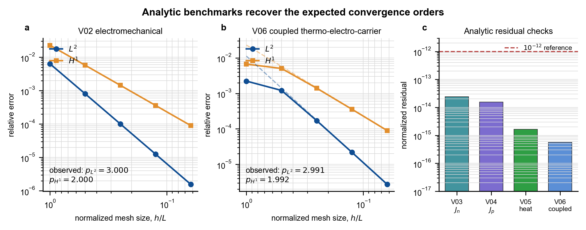
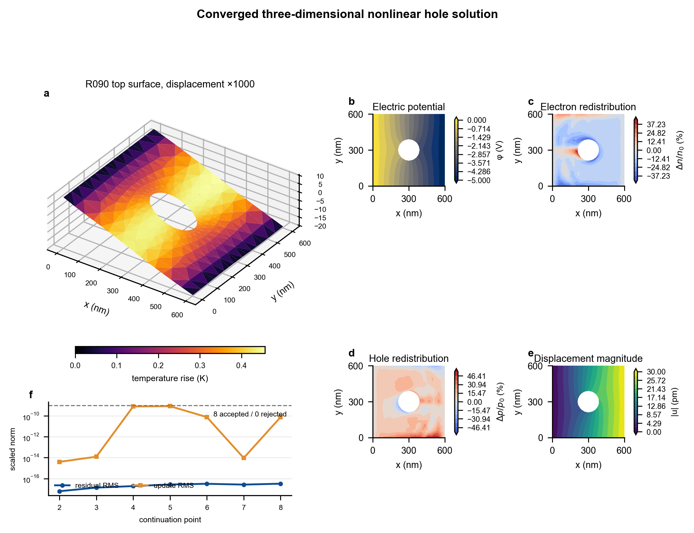
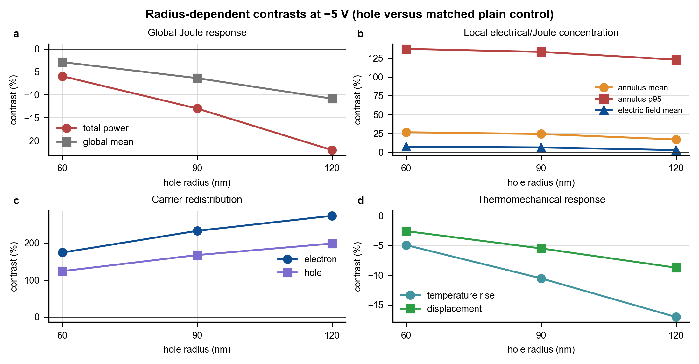

# TPSolverV2 历史验证报告（孔洞结果已被 2026-09-06 几何审计标记为过期）

> 重要状态：本报告保存旧结果的来源链，但不能作为当前孔洞物理结果的最终证明。独立 HEX20 边界迹审计发现旧 G10/G12/G13 分级圆孔网格存在负 Jacobian。请先阅读 `../docs/geometry_audit_findings_20260906.md`。A1J、G09 和修复后的 G10 已重新通过；G12/G13 仍待重新生成最终证据。

## 1. 历史结论（已撤回，不代表当前状态）

在冻结的理论与适用范围内，`TPSolverV2 0.13.0-a1j-flux-audit` 已完成从理论表达、材料点、单元、全局装配、边界条件、线性求解、解析解、全局一致 Jacobian、Newton、延续策略、守恒、孔洞几何、网格敏感性、独立通量审计到跨编译流程复现的完整检查，最终状态为 **VERIFIED**。

这个结论的准确含义是：当前程序正确实现了理论基准 2.1 中已经冻结并在代码中启用的方程，并能稳定求解本报告规定的三维非线性中心孔洞问题。它不等同于材料参数已由实验标定，也不证明模型边界之外的挠曲电、复合、接触效应或高场输运。

## 2. 冻结对象

- 理论：`thermo_piezo_semiconductor_two_carrier_theory_v2_1`。
- 架构：`TPS-V2-ARCH-001`。
- 数值未知量：`[u1,u2,u3,phi,eta_n,eta_p,theta]`。
- 浓度变量：`n=n_ref exp(eta_n)`，`p=p_ref exp(eta_p)`，从变量定义上保证正浓度。
- 物理范围：稳态、小应变、静电、线性热压电本构、双载流子低场漂移—扩散、温度相关迁移率/扩散、漂移电导型焦耳热。
- 当前冻结：复合率 `R=0`；不含挠曲电、瞬态、接触电阻、Seebeck/Peltier 和完整半导体热源。
- 三维孔洞算例：`600 nm × 600 nm × 20 nm` 板，中心圆孔，`−5 V`，材料 `TPS_G08_REFERENCE`。

完整理论推导、弱式和全部 Jacobian 块见 `../../output/theory_v2/thermo_piezo_semiconductor_two_carrier_theory_v2_1.pdf`；可编辑 LaTeX 源文件为同目录 `.tex` 文件。

## 3. 最初程序框架与当前实现的对应关系

旧单文件程序只作为历史参考，未被编译进入新版求解器。新版保持原问题的有限元求解流程，但把每一层职责分开：

1. 输入与模型注册：`src/io`、`src/problems`；
2. HEX20 几何、形函数、积分和自由度映射：`src/mesh`；
3. 本构、输运、复合接口和材料点切线：`src/physics`；
4. 单元残差与一致 Jacobian：`src/fem/element_kernel_m.f90`；
5. 全局 CSR、装配与 Dirichlet 处理：`src/fem`；
6. PARDISO、缩放、真实残差 Newton 和电压/焦耳热延续：`src/linear`、`src/nonlinear`；
7. 守恒、积分指标和结果输出：`src/post`；
8. 每个数值门禁的独立验证入口：`src/verification`。

编译流程没有被绕开：命令行 ifx 构建和 Visual Studio 清洁重建均已执行，Visual Studio 为 0 error、0 warning；两套可执行文件虽然具有不同二进制哈希，但 G00–G12、L01 及三个生产算例的文本/数据输出逐字符一致。完整构建清单、输入快照和 SHA-256 见 G00–G12 证据目录。

## 4. 正确性证据链

| 需要确认的问题 | 门禁与结果 | 能够支持的结论 |
|---|---|---|
| HEX20 几何与插值是否正确 | V01 最大误差 `1.78e−15` | 形函数、映射及基本积分实现正确 |
| 材料公式和局部导数是否一致 | G02 最大方向导数误差 `1.79e−11` | 材料点响应与解析切线一致 |
| 单元残差/Jacobian 是否一致 | G03 最大误差 `1.18e−10` | 单元级五类残差及切线一致 |
| 全局装配、共享节点和边界是否正确 | G04 最大误差 `1.68e−10` | CSR、散射和 Dirichlet 处理一致 |
| 线性求解与七场缩放是否正确 | L01，224 方程误差 `1.60e−12` | PARDISO 与缩放链可靠 |
| 是否恢复已知解析解 | G05 PASS | 见第 5 节 |
| 生产 M2 的全部耦合 Jacobian 是否正确 | G06 全局 5×7 分块最大误差 `4.90e−12`，结构零泄漏 `0` | 实际装配路径的一致切线通过数值审计 |
| Newton 是否收敛到同一根且满足守恒 | G07 暖启动 5 次、冷启动 9 次，解差 `1.02e−13`，最大守恒缺陷 `1.26e−15` | 收敛不是初值偶然，并满足离散守恒 |
| 非线性加载失败后能否可靠恢复 | G08 两次真实 cutback、精确 rollback，路径差 `3.72e−14` | 延续、回退和重启逻辑正确 |
| 孔洞边界和三维几何是否正确 | G09 孔壁边界重叠 `0`，体积误差 `3.75e−6` | 中心孔几何与自然边界处理正确 |
| 孔边局部结果是否依赖网格 | G10；R090 六项 L1→L2 变化均小于 `1.16%` | R090 的冻结积分/分位数指标已网格稳定 |
| 有孔/无孔对照是否可比 | G11-v2；外边界失配 `2.65e−22 m`，环带体积误差均低于 `1%` | 对照几何和局部积分一致 |
| 半径端点是否同样网格稳定 | G13；R060 改善 6/6，R120 改善 5/6，均 PASS | 60/120 nm 端点的冻结指标通过敏感性检查 |
| 结果能否复现 | 所有门禁两次 CLI 精确一致；IDE/CLI 精确一致 | 当前代码、输入和构建流程具有确定性 |
| 生产结果的体积分/边界通量是否可独立复核 | A1J；13 个生产路径子算例通过独立 4/5 阶积分、解析场、守恒和负控制 | 生产结果不只依赖组装残差；通量与积分诊断已保存到结果文件 |

所有阈值均在相应结果产生前冻结；失败记录没有通过放宽阈值被改写。G11-v1 暴露的无孔环带积分误差为 `7.89%`，随后以 8×8 切割单元积分修正；v2 的 H00/H02 误差降为 `0.874%/0.0522%`。

## 5. 解析解验证

G05 把一维解析场嵌入三维 HEX20 网格，并与程序实际有限元解比较。M0 仅表示参考态附近的一阶模型，严格删除二阶漂移项，不冒充 M2 非线性生产方程。

- V02 力—电—电子屏蔽：电势误差观测阶为 `L2 = 3.000`、`H1 = 2.000`；
- V06 热—压电—电子联合解：电势误差观测阶为 `L2 = 2.991`、`H1 = 1.992`；
- V03 电子零电流：归一化最大电流 `2.42e−14`，并恢复正确的电子漂移—扩散符号；
- V04 空穴零电流：归一化最大电流 `1.55e−14`，并恢复与电子相反的空穴扩散关系；
- V05 均匀热源：能量不平衡 `1.63e−15`；
- V06 联合零电流残差 `5.58e−16`。

这组结果证明离散格式恢复了冻结小扰动方程的解析解和 HEX20 预期收敛阶；它与 G06 的生产模型 Jacobian 审计互补，分别检查“已知答案”和“完整非线性导数”。A1J 是额外的生产路径热学/通量子门禁，不作为第三类论文解析解。

## 6. 三维非线性中心孔洞算例

用于最终场图的 R090-L2 算例包含 1056 个节点和 128 个 HEX20 单元。加载从零态开始，先增加电压，再增加焦耳热反馈：

- 最终电压因子 `1.0`，焦耳热因子 `1.0`；
- 8 个 continuation 点全部接受，0 次拒绝；
- 总 Newton 迭代数 33；
- 最大电荷/电子/空穴/热守恒缺陷 `2.21e−16`；
- 边界误差 `0`。

顶面节点范围仅用于帮助阅读场图：`phi = −5…0 V`，温升 `0…0.46 K`，电子相对变化约 `−43.44%…41.05%`，空穴相对变化约 `−28.87%…54.14%`，位移模 `0…30 pm`。三维变形图把位移放大 1000 倍，颜色表示温升；二维场采用节点插值，因此定量论断仍以独立 Gauss 积分得到的 G10–G13 指标为准。

图中可以确认：孔洞扰动了电势等值线；电子和空穴发生局部且不同符号的重分布；热源、去除材料、导热路径和定温边界共同形成温度场；热膨胀和压电耦合进一步形成位移场。该解在本模型内是收敛且守恒的，但场图不能单独证明真实材料中的实验幅值。

## 7. 孔半径矩阵

相对于具有相同外边界分辨率的无孔对照，`r = 60/90/120 nm` 的结果为：

| 指标 | 60 nm | 90 nm | 120 nm |
|---|---:|---:|---:|
| 总焦耳功率 | −5.94% | −12.99% | −22.04% |
| 全域平均焦耳热 | −2.89% | −6.37% | −10.84% |
| 孔边 30 nm 环带焦耳热均值 | +26.53% | +24.18% | +16.91% |
| 孔边环带焦耳热 P95 | +137.25% | +133.24% | +122.86% |
| 孔边环带电场均值 | +7.47% | +6.35% | +2.81% |
| 电子浓度重分布指标 | +174.05% | +232.72% | +273.34% |
| 空穴浓度重分布指标 | +123.83% | +167.34% | +198.47% |
| 孔边平均温升 | −4.95% | −10.55% | −17.08% |
| 孔边平均位移 | −2.59% | −5.50% | −8.75% |

最重要的解释是：局部焦耳热集中并不要求局部平均温度上升。孔洞使环带焦耳热均值和 P95 增大，但同时降低了总焦耳功率，并改变材料体积、热传导路径和边界散热，因此本算例中孔边平均温升反而下降。该趋势是当前冻结参数和边界条件下的数值结论，不应扩展成普适物理定律。

## 8. 证据与复现入口

- G00–G12 + A1J + L01 总证据：以最新 `runs/*_G00_G13_A1J_L01/validation_report.md` 为准。
- G13 端点网格敏感性：`../runs/20260902T132814Z_G13_ENDPOINTS/validation_report.md`。
- 解析验证规范：`../docs/g05_m0_benchmark_spec_v1.md`。
- 完整 Jacobian 审计规范：`../docs/g06_v07_block_jacobian_spec_v1.md`。
- 图形契约：`../docs/final_figure_contract.md`。
- 可重复后处理脚本：`../scripts/postprocess_final_results.py`。
- 图形及源数据哈希：`qa/figure_manifest.json`。

## 9. 历史停止条件（已失效）

以下停止条件属于几何审计之前的历史记录，现已失效：原目标曾被记录为完成，但修复后孔洞重验证、版本证据更新和图表重新绑定尚未全部闭环。不得据此停止重验证或复用旧图。C04 电压路径、实验标定、非零复合和挠曲电仍属于本次数值重验证范围之外的问题。
