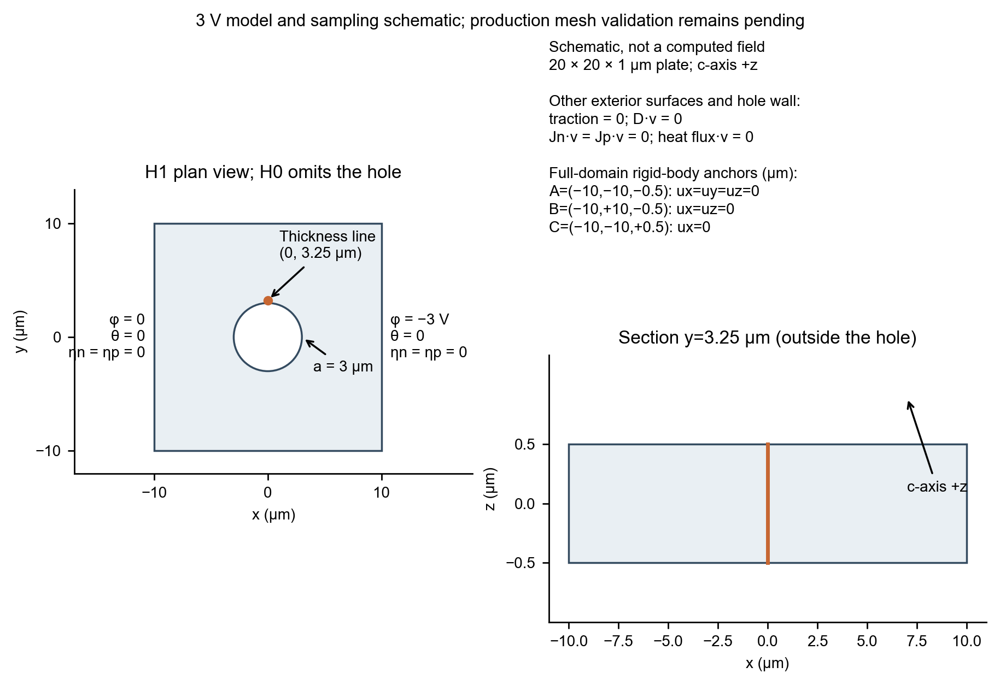
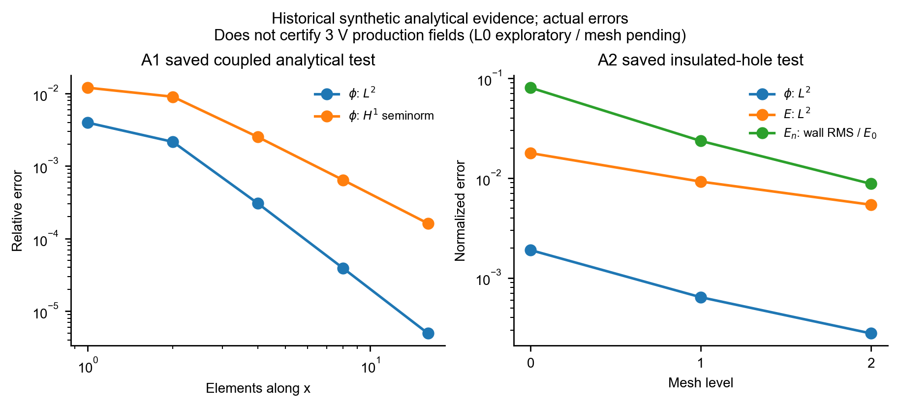
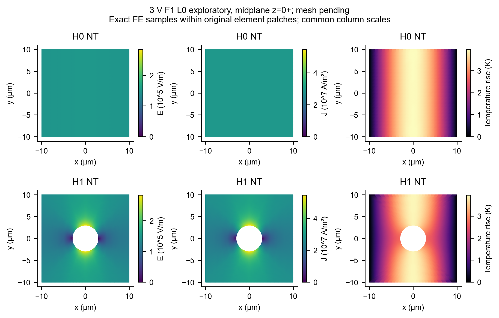
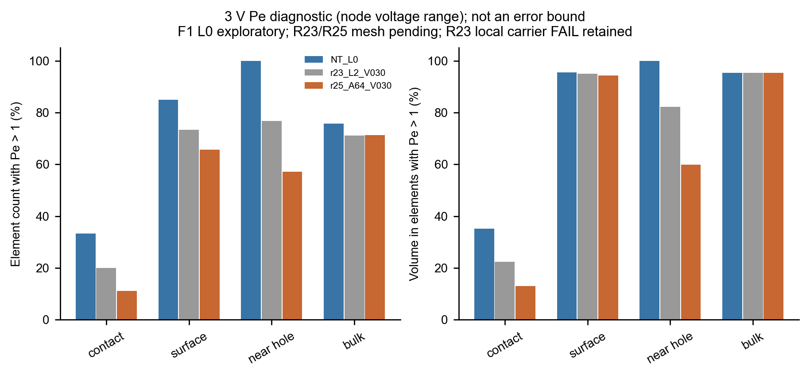
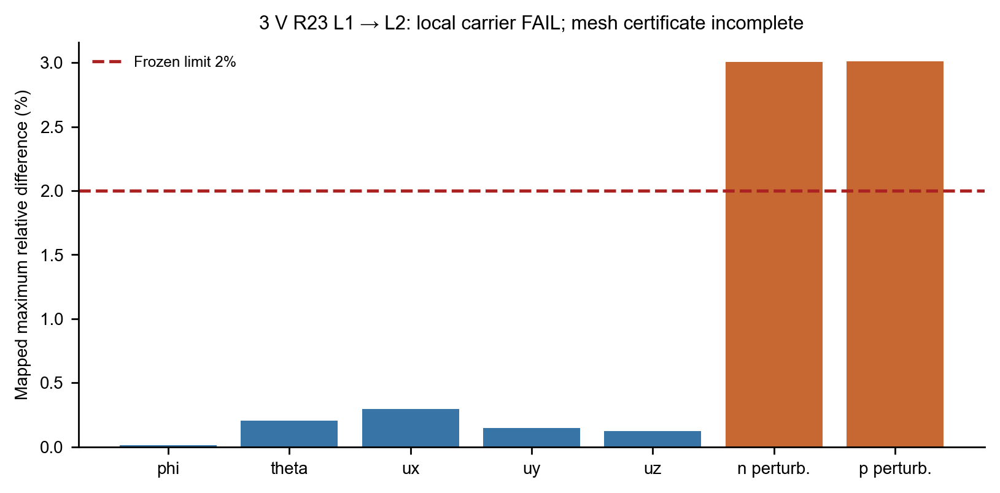
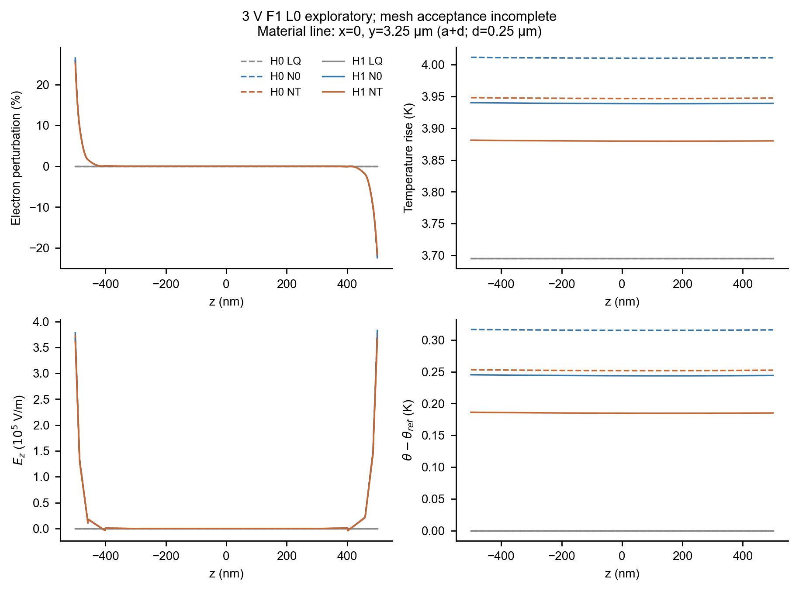
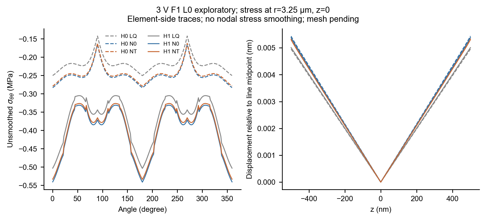
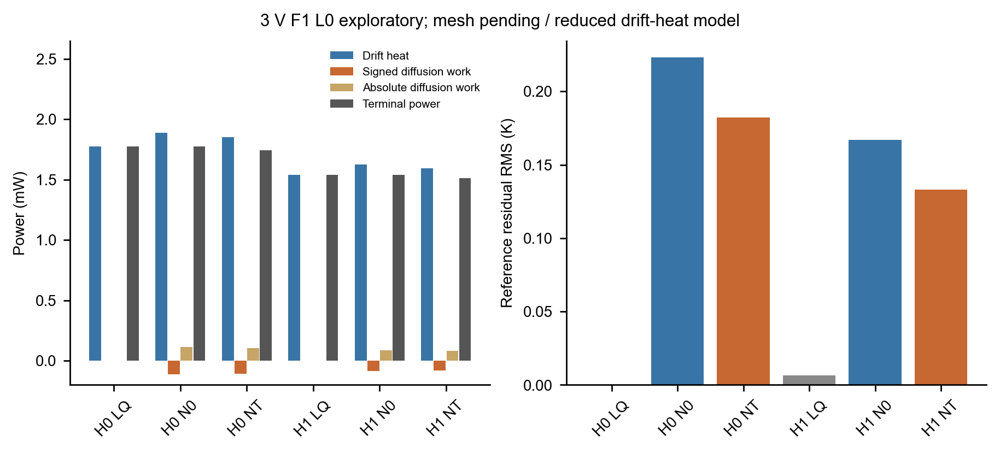

# 含圆孔ZnO压电半导体板详细研究报告

WORKING_DRAFT · 2026年10月8日 · 本地证据核查与论文工作依据

**版本冻结说明：** 本报告的源码及新验证结论限定于启动时核验的0.15.9 / R25_CLEAN。21:53终检发现工作区被外部并行任务更新为0.16.0-trust-region；本轮没有验证该后续版本，也未覆盖其修改。下文“当前源码”均按本次证据快照理解。

## 1 研究结论与本次任务边界

本次已经能够形成具有真实源码、运行日志和原始场依据的研究报告及论文工作初稿；现有证据尚不足以形成经过完整空间验收和材料实验标定的定量论文结论。这里的限制不是求解器完全不可用，而是“残差收敛”“物理通量闭合”“局部场分辨率”“模型物理适用性”需要分别成立。历史粗网格的通过状态必须保留其原始限定，不能升级成统一的全场PASS。

研究范围冻结为20 μm×20 μm×1 μm的ZnO板，无孔H0与半径3 μm贯穿圆孔H1，正晶体c轴沿全局正z。采用3 V作为可比较的历史工作电压，而不是声称3 V已经成为无条件可信的器件工作电压。现有H0/H1×LQ/N0/NT六组完整场可用于带限定的重分析；新版本3 V的方向加密和半域结果单独登记，不与旧全域F1混成同一版本、同一离散格式的生产矩阵。

本轮没有新增实体实验，没有改变材料、热源、稳定化、生产边界或精度门槛，没有新增高压扫描、新几何或新物理。原有高压进程保持运行，其结果不作为本研究的完成前提。重要的未闭合事项是3 V局部载流子空间检查失败、NT−N0差值未有匹配多网格证书，以及漂移电导热源在漂移—扩散抵消区域的解释限制。

## 2 基线保护与证据身份

真实Git仓库位于工作区的solver_v2目录，外层Console3不是有效的当前程序仓库。启动时HEAD为`a63ad1db24a5d5813afa4fbbe7eaa6e7235950bc`；受保护标签`baseline-pre-stabilization-20260915`的标签对象为`d01d73dd263f81c27423469c27b09ab4d28fa040`，解引用提交与HEAD相同。标签对象哈希和提交哈希不同是带注释标签的正常结构，不是基线移动。

工作树含大量既有未提交源码、测试、脚本与文档修改。本次在同一HEAD创建`codex/paper-sprint-20261008-2110`分支，未清理、暂存、提交、推送或重置用户修改。启动时保存Git状态、完整已跟踪差异及当前源码SHA-256；最终保护检查另附。所有新增成果集中在`paper_sprint/20261008_2110/`，首版正文独立保留，不覆盖历史产物。目录联接解析可能显示旧物理路径；该路径别名不改变solver_v2唯一有效源码原则。

当前可执行程序为`build/HV_LOG_INVERSE_20261008_R25_CLEAN/TPSolverV2.exe`，运行时版本为`0.15.9-log-inverse-checked`。本次核对58份Fortran源文件及可执行程序共59项，与对应构建清单逐项哈希匹配；可执行程序SHA-256为`a47da18f47ceca0209ef9b6fcc17bb13c1175f4e3a3181ffc1eb4d7b7f2f6814`。旧清单顶层版本字符串存在漂移，其历史记录保留，科学追踪以逐文件哈希和实际版本调用为准。

生产物理目录`src/physics/`相对基线提交的差异为空；但单元弱式、求解控制和可选半域路径已经发展。不能用“物理源码未改”推导全部离散解逐字节不变。详见`audit/source_validation/MODEL_CONTRACT_DIFF.md`及带真实行号和哈希的`source_index.md`。

最终保护核查显示HEAD、main引用与受保护标签未改变；工作树本身不再等于启动快照。版本标识、模型选项、输入解析、Newton、温控及验证驱动等8份源码有并行变化，清单保存在`audit/concurrent_source_changes.json`。这些变化不是本任务实施，未被回滚或纳入本报告PASS范围。启动与结束的用户差异均保留；既有R25程序和历史场证据按其独立哈希冻结，不能给0.16.0补发验证结论。

## 3 模型契约与材料适用性

### 3.1 变量与本构

程序使用SI单位，HEX20每节点未知量依次为$(u_1,u_2,u_3,\phi,\eta_n,\eta_p,\theta)$，每单元140个自由度。令$T=T_0+\theta$、$\mathbf E=-\nabla\phi$，小应变采用工程剪切Voigt排列$(xx,yy,zz,yz,zx,xy)$。模型为

$$
\boldsymbol\sigma=\mathbf C\boldsymbol\varepsilon-\mathbf e^T\mathbf E-\mathbf b\theta,
\qquad \mathbf D=\mathbf e\boldsymbol\varepsilon+\boldsymbol\kappa\mathbf E+\boldsymbol\pi\theta,
\qquad \mathbf b=\mathbf C\boldsymbol\alpha .
$$

热释电向量使用$\boldsymbol\pi$，与空穴浓度$p$区分。无体力、无产生复合的稳态控制方程为

$$
\nabla\cdot\boldsymbol\sigma=0,\quad
\nabla\cdot\mathbf D=q(p-n+N_D-N_A),\quad
\nabla\cdot\mathbf J_n=\nabla\cdot\mathbf J_p=0,\quad
\nabla\cdot\mathbf q_h=Q_d.
$$

非线性浓度在有限元中应由插值后的对数变量恢复：$n=n_0\exp(\eta_n)$、$p=p_0\exp(\eta_p)$，不是先指数化节点浓度再线性组合。相应电流及热流为

$$
\mathbf J_n=qn(\boldsymbol\mu_n\mathbf E+\mathbf D_n\nabla\eta_n),\qquad
\mathbf J_p=qp(\boldsymbol\mu_p\mathbf E-\mathbf D_p\nabla\eta_p),\qquad
\mathbf q_h=-\mathbf k\nabla T .
$$

热源为$Q_d=q[n\mathbf E\cdot\boldsymbol\mu_n\mathbf E+p\mathbf E\cdot\boldsymbol\mu_p\mathbf E]$，即漂移电导项；它不等于总电流做功，也不构成完整的载流子能量方程。当前复合及其导数为零。模型不包含陷阱、非完全电离、高场迁移率、显式载流子热扩散、挠曲电和瞬态。本次未对任何一项作静默增补。

### 3.2 三模型和新离散格式

| 模型 | 密度、电流和输运定义 | 可作出的比较 |
|---|---|---|
| LQ | 一阶相对浓度；电流和热源使用参考密度；三阶段顺序求解 | 近似模型参考，非完整反馈平衡态 |
| N0 | 指数浓度；迁移率与扩散系数同时固定在参考温度 | 常输运系数非线性耦合响应 |
| NT | 指数浓度；迁移率和扩散系数随温度变化 | 所选温变输运模型的总反馈 |

LQ第一阶段固定温度且关闭热源，求其余字段；第二阶段固定前六场，仅求温度；第三阶段固定电势、双载流子和温度，仅更新位移。第三阶段后没有返回电—载流子方程。因此N0−LQ同时含密度非线性和反馈路径差异，不能定义为纯载流子非线性贡献。

NT中$\mu_s=\mu_{s0}(T/T_0)^{-\beta_s}$、$D_s=k_BT\mu_s/q$，一致导数分别为$\partial_T\mu_s=-\beta_s\mu_s/T$、$\partial_TD_s=(1-\beta_s)D_s/T$。N0把两者及温导数一同冻结。NT−N0不是纯迁移率贡献。

当前源码另有默认关闭的对数加权输运测试函数$w_i=e^{-\eta}N_i$。其弱式包含$e^{-\eta}(\nabla N_i-N_i\nabla\eta)\cdot\mathbf J$，切线需计入测试函数的状态导数。它保持物理电流和热源定义，但改变有限维测试空间；加权自由行平衡不是原物理电流守恒。旧F1普通Galerkin和新R25对数加权结果不能混成一个网格序列。该选项与SUPG及LQ互斥；本轮仅审计已有实现，没有新增稳定化。

### 3.3 材料数值及其证据等级

| 参数 | 当前源码值 | 解释边界 |
|---|---|---|
| $C_{11},C_{12},C_{13},C_{33},C_{44}$ | 209.7,121.1,105.1,210.9,42.47 GPa | 混合来源候选参数，非本项目同样品标定 |
| $C_{66}$ | 44.3 GPa | $(C_{11}-C_{12})/2$ |
| $e_{31},e_{33},e_{15}$ | −0.62,0.96,−0.37 C/m² | 工程剪切约定，无额外倍乘 |
| 相对介电常数 | 8.54,8.54,10.2 | 定应变解释仍有实验约束核录缺口 |
| 热膨胀系数 | 4.31,4.31,2.49 ×$10^{-6}$ K$^{-1}$ | c方向文献汇编内部差异待查 |
| 一次热释电系数$\pi_3$ | −6.9 ×$10^{-6}$ C/(m² K) | 不替代自由应力总热释电系数 |
| $k,T_0$ | 60 W/(m K),300 K | 各向同性有效热导率，非1 μm同样品实测 |
| $n_0,\mu_{n0}$ | $6\times10^{22}$ m$^{-3}$,0.0205 m²/(V s) | Hall因子取1为明确假设 |
| $\mu_{p0},\beta_n,\beta_p$ | 0.005 m²/(V s),2,2 | 空穴及温度指数未独立标定 |
| $n_i,p_0$ | $2.9\times10^{-4}$,$1.4016666667\times10^{-30}$ m$^{-3}$ | $p_0=n_i^2/n_0$，不人为抬高少数载流子 |

既有材料审计指出弹性原始来源的绝热条件与当前等温使用不同，压电、热学和输运参数并非来自同一试样；热导率、Hall因子和迁移率温度指数属于有效假设。当前源码实际已启用该候选材料，旧材料审计中的“production_enabled=false”是当时准备阶段状态，不是当前事实。这些局限允许进行给定模型的数值研究，但阻止将百分比温度修正表述为已校准真实器件规律。

### 3.4 几何和边界

全域为$[-10,10]\times[-10,10]\times[-0.5,0.5]$ μm。左右电极分别为$\phi=0$和$-3$ V，双载流子扰动及温升均为零。其余表面和孔壁采用零牵引、零法向电位移、零法向电流和零热流。零电位移自然边界不等于已求解孔内空气场，也不包含表面电荷、孔壁陷阱或接触热阻。

全域刚体约束为A=(−10,−10,−0.5) μm固定$u_1,u_2,u_3$；B=(−10,10,−0.5) μm固定$u_1,u_3$；C=(−10,−10,0.5) μm固定$u_1$。本次力学比较保持该参考，不通过任意平移改变峰值。新半域路径采用$y\ge0$及不同的刚体约束，体积分是实际半域量；与全域比较须显式处理对称重构和位移参考，不能按峰值或节点编号简单倍乘。

## 4 电热参考关系与功率反例

在连通域、常数各向同性电导率$\sigma_0>0$和热导率$k>0$、两电极电势0与$-V$、两端等温、其他表面电绝缘且绝热的约化模型中，令$\psi=-\phi$，有$\nabla^2\psi=0$和$-k\nabla^2\theta=\sigma_0|\nabla\psi|^2$。由于

$$
\nabla^2[\psi(V-\psi)]=-2|\nabla\psi|^2,
$$

构造解$\theta_*=\sigma_0\psi(V-\psi)/(2k)$满足相同方程、电极温度和绝热边界。由热混合边值问题唯一性，$\theta=\theta_*$；若域内电势可取$V/2$，则

$$
\theta_{\max}=\frac{\sigma_0V^2}{8k}.
$$

取当前参考态$\sigma_0=q(n_0\mu_{n0}+p_0\mu_{p0})=197.067725982$ S/m、$V=3$ V和$k=60$ W/(m K)，解析参考峰值为3.6950198622 K。该数值是代数计算，不是新三维求解或LQ验证。该关系允许存在绝缘绝热孔洞，说明“总功率变化大而峰温变化小”并不足以独立建立半导体耦合机制。不同热边界、非比例各向异性和温变输运不自动满足该关系。

完整模型定义$r_T=\theta-\sigma_0\psi(V-\psi)/(2k)$。带权均方根采用$[\int r_T^2\,dV/\int dV]^{1/2}$；最大绝对值必须报告采样定义，有限采样最大值不是严格连续极值。电势超出端点区间时不裁剪。非零$r_T$同时包含模型偏离与离散误差，不是某一种物理作用的净贡献。

电功率采用进入材料为正的约定：$P_{term}=-\int_{\partial\Omega}\phi\mathbf J\cdot\nu\,dS$。积分分部给出

$$
P_{term}=\int_\Omega\mathbf J\cdot\mathbf E\,dV-\int_\Omega\phi\nabla\cdot\mathbf J\,dV.
$$

因此只有电流散度为零且积分一致时，端口功率才等于体积总电流做功。应分别记录$P_d=\int Q_d$、$P_{diff}=\int\mathbf J_{diff}\cdot\mathbf E$、$P_{diff,abs}=\int|\mathbf J_{diff}\cdot\mathbf E|$和外边界热流，而不能强行配平。

恒温电子平衡满足$\mathbf E+(k_BT/q)\nabla\ln n=0$时，总电子电流可为零，漂移电导热源却仍可正。这是当前热源的物理解释边界，不是授权将热源直接替换为$\mathbf J\cdot\mathbf E$。即使全局有符号扩散功率很小，局部正负抵消仍可能较大；全局小量也不能证明完整热力学闭合。

## 5 实际验证及其覆盖范围

本次优先使用与当前源码哈希匹配的R25_CLEAN程序，在新目录顺序执行版本、V01、V02、G02、F1M和G03调用。首次运行因Intel动态库搜索路径缺失，以`0xC0000135`失败；失败日志保留。将已安装编译器bin加入本任务子进程PATH后，版本及五项验证全部退出0，验证输出PASS。没有安装环境或重编生产程序。当前安装环境识别为ifx 2024.2.1、MKL 2024.0.2；这不是本轮重新编译的记录，也不替代历史构建身份。命令、哈希、退出码和原始输出保存在`validation/runtime_retry/`。

同时重放已有R22生产HEX20条带程序，输出与历史stdout逐字节一致。其二进制、驱动、模块和对象共61项身份匹配；这是R22归档生产核重放，不能冒称当前R25加权路径已重新编译测试。该程序使用真实材料点与单元残差/Jacobian，但采用自定义一维缩约装配和稠密解法，不能等同完整CSR及生产Newton路径。域Pe=1000，即$A=2000$，128单元，最大单元Pe约23.255；电子浓度/电流采样最大误差分别为$7.5958331\times10^{-5}$和$2.5183307\times10^{-3}$，空穴分别为$4.0479196\times10^{-5}$和$1.6628814\times10^{-3}$。这些是每单元11点的特定归一化采样误差，不是独立相对$L^2$误差。

附件要求的$A=0,1,10,40,-40$以及4/16/64单元完整生产验证矩阵尚未完成。既有电子/空穴镜像不能替代同种电子反向电场检查；生产路径的零场、负场、独立误差积分稳定性、完整剖面及自由载流子行残差仍为PENDING。本轮已另完成上述五个A的纯数学参考检查：端点误差为0，解析恒流相对最大偏差$3.55\times10^{-16}$，独立Simpson功率检查最大相对差$1.23\times10^{-12}$，零场极限通过预先冻结的容差。原始参考CSV和契约见`validation/formula_reference/`。这些检查只核查闭式解及实现，不能补成生产路径PASS。本轮一维生产规格状态仍为PARTIAL_REUSED_EVIDENCE。

三维原门槛保持：最大阶段balance小于$10^{-8}$，残差和增量各小于$10^{-9}$，独立热流和电子电流缺口小于1%，四/五阶热源积分差小于0.1%。这些门槛对应不同检查，不是空间误差界。历史F1重复运行虽然数值差接近浮点精度，但逐字节复现检查原为FAIL，仍保留FAIL。

历史A1/A2解析验证原日志现已重新提取为CSV和误差图。A1最细层电势相对$L^2$误差为$4.943250\times10^{-6}$，A2最细层电势/电场相对$L^2$误差分别为$2.782470\times10^{-4}$和$5.408310\times10^{-3}$。这些是各自合成条件下的历史记录，既不是本轮V02也不是本轮新增三维结果。它们可以支持特定算子与边界处理的验证背景，不能直接认证生产场。

## 6 三维数据核查与后处理结果

### 6.1 数据来源与独立重构

本次分析10个3 V状态：六个历史F1全域L0状态、三个R23对数加权半域L0/L1/L2状态和一个R25 A64半域状态。每例核查输入、模型、原始节点场、网格、构建及相关源码快照；后四例只作数值诊断。六个F1状态原求解/通量门槛均通过，但总体审计保留重复运行逐字节失败及网格未验收标记。本次不会仅凭目录名或`PASS_NOT_MESH_ACCEPTANCE`归为完全验证。

来源链复核还发现，F1的H0三例缺少运行当时的逐case provenance.json。现存54份归档源、可执行文件、输入和网格的哈希匹配可确认，但进程/环境来源是后补追溯，不能反推完整的实时运行记录。因此H0的provenance_status保持PENDING，其图表只能作为已匹配现存档案的探索性重分析，不能给无孔/有孔对照颁发完整来源证书。H1有当时记录；R23/R25对应58份归档源均匹配。这个发现及修正记录在`audit/postprocess/metadata_correction.json`，没有静默补写历史记录。

有限元重构使用原始HEX20形函数、几何映射和梯度，按模型定义恢复浓度、材料响应和应力，体积积分使用独立五阶规则。每例第1单元第1个五阶点的多场重构最大尺度误差小于$4.8\times10^{-9}$，漂移热体积分与原指标相对差小于$3\times10^{-13}$。前者是抽样一致性核对，不是核查了全部采样点；后者核对完整体积分。本轮端口功率和外边界热流复用已归档的独立边界审计，体积$P_d$、$P_{diff}$及$\int\mathbf J\cdot\mathbf E$则重新重构。这些检查不是重新求解，也不证明局部空间误差已消失。大体积原始场留在原目录，本次CSV、哈希清单和可重跑脚本提供追踪。

### 6.2 六组主状态标量

表中全部为**历史L0探索性结果，未完成空间验收；H0另缺运行当时完整来源记录**。峰温来自原保存积分采样最大值；$E_{95}$为本轮五阶体积分采样的体积加权电场P95；$P_d$为本轮独立漂移热积分。不同取样集合的最大值不能互换。

| 状态 | $P_d$ (mW) | 保存峰温 (K) | $E_{95}$ (kV/m) | 原独立热流缺口 (%) |
|---|---:|---:|---:|---:|
| H0-LQ | 1.773610 | 3.693185 | 150.000 | $1.04\times10^{-10}$ |
| H0-N0 | 1.886268 | 4.025150 | 159.524 | 0.744521 |
| H0-NT | 1.850211 | 3.960885 | 158.976 | 0.716592 |
| H1-LQ | 1.539512 | 3.694630 | 185.874 | 0.00007222 |
| H1-N0 | 1.624653 | 3.967210 | 198.926 | 0.652391 |
| H1-NT | 1.594473 | 3.906878 | 200.266 | 0.629212 |

历史L0数据呈现孔洞改变电场分布、总热功率和导热路径的趋势，但不支持把某个精确差值直接提升为网格收敛结论。H1的NT峰温低于N0，在指定温变输运模型中可作为反馈方向的探索性观察；其幅度是否可分辨需要同电压、同离散格式的多网格N0/NT对照。

### 6.3 漂移与扩散功率

下表仍为**历史L0、未完成空间验收；H0完整实时来源链PENDING**，使用全域体积积分和物理外边界端口功率，单位均为mW。正号端口功率表示输入材料。负的扩散电功率说明该积分项抵消了部分漂移做功，不等同于独立的负热源测量。

| 状态 | $P_d$ | $P_{diff}$ | $P_{diff,abs}$ | $P_{term}$ | 热边界流出 |
|---|---:|---:|---:|---:|---:|
| H0-N0 | 1.886268 | −0.112659 | 0.112685 | 1.773597 | 1.872225 |
| H0-NT | 1.850211 | −0.107200 | 0.107225 | 1.743000 | 1.836953 |
| H1-N0 | 1.624653 | −0.085141 | 0.085156 | 1.539499 | 1.614054 |
| H1-NT | 1.594473 | −0.081186 | 0.081201 | 1.513271 | 1.584440 |

H0-NT和H1-NT的$P_{diff,abs}/P_d$分别约5.80%和5.09%。这表明在本模型的既有状态中，扩散做功不是可以无说明略去的解释项。但功率比与峰温差具有不同物理含义，不能直接把该比例当成真实温度误差。热方程闭合的是$P_d$与热流，不是$P_{term}$与热流；当前程序通过其原热平衡门槛，仍不意味着满足完整电—载流子能量闭合。

本次还独立计算$\int\mathbf J\cdot\mathbf E$。六例中四个非线性全域状态的端口—体积分相对缺口约$6.7\times10^{-6}$至$1.0\times10^{-5}$，不强行置零。半域另同时保留包含人工切面的全边界功率和物理外表面功率，不将真实半域体积量与全域值直接比较。

### 6.4 Pe分布和空间检查

采用单元20节点电势跨度和单元节点平均温度计算Pe；N0使用冻结$T_0$。H0-NT中$Pe>1$的单元计数比例约28.57%，但体积比例为95%；H1-NT相应约82.14%和95.36%，最大Pe约17.67。计数比例会被大量薄层单元影响，不能替代体积比例。体内粗区、孔周、表层和接触区按预先保存的分组规则分别输出。该结果说明仅把表面第一层变薄不足以消除沿场粗区风险。

### 6.5 厚度与机械响应

固定孔外材料位置$(x,y)=(0,3.25)$ μm，距孔壁$d=0.25$ μm；H0采用同一物理坐标。厚度线覆盖$z\in[-0.5,0.5]$ μm，保存实际电势、温升、对数变量及相对浓度。该线位于材料内，不经过空孔。曲线按原有限元重构，不以图形平滑替代边界层分辨率检查。

历史L0的H0-NT和H1-NT在该线两表面的厚度位移差分别约10.7011 pm和10.6042 pm；它们是局部厚度变化，而不是位移模长全域最大值。相对位移另以该线中面作为参考，保留未扣除的真实应变。孔外中面固定半径处的切向应力保留未平滑采样，H1-NT当前采样最大绝对值约0.533870 MPa。此值没有局部空间峰值证书，不用于强度或失效判断。

### 6.6 常系数温度参考偏离

历史L0中H0-LQ的参考偏离加权RMS约$1.47\times10^{-15}$ K，而H1-LQ约0.006631 K，采样最大绝对偏离约0.033247 K。H0-LQ的数值一致性是特定场状态的重构观察，不替代一般含孔参考模型验证。H0-NT和H1-NT的RMS偏离分别为0.182217 K和0.133217 K，最大绝对偏离分别为0.268542 K和0.214867 K。

新R25 A64半域3 V状态的峰温为3.908348 K、参考RMS偏离0.134604 K，原热流缺口约0.069694%；该状态仍为SOLVE_FLUX_PASS_MESH_PENDING。它提供新格式下的已求解诊断点，而不能补成旧F1的同版本N0/NT模型差值，也不能仅凭整体温度稳定解除载流子场的空间缺项。

## 7 空间精度与结论门槛

已核对的新3 V R23三层比较中，原整体指标通过并未解除局部场风险：L1→L2电子和空穴相对扰动差异分别约3.0065%和3.0098%，超过预设2%局部场门槛。该FAIL禁止“完整3 V全场已网格收敛”的表述。其他电压方向加密或积分对照通过，不可迁移成3 V同条件证书；分别通过角向、径向和厚度检查也不自动成为未运行的联合细网格证书。

历史H0环带积分点筛选体积比解析环带低约28.48%，因此不把H0/H1环带比值作为定量几何结论。无孔与有孔的体积分、相同物理位置厚度线和相对位移仍可分别评估。对近零载流子差值使用恰当绝对尺度，不以趋近零的分母制造大百分比；对非系统网格不套用无依据的Richardson阶次或GCI。

后处理Pe定义为$Pe_K^\phi=(\max_K\phi-\min_K\phi)/(2D/\mu)$。NT用当地温度的$D/\mu=k_BT/q$；N0使用固定$T_0$。节点极值和附加采样点极值要分别说明；HEX20内部极值可能不在节点。Pe是漂移占优风险指标，不是任意二次单元的严格误差界。LQ的Pe只能作背景场诊断，因为其线性化载流子算子没有完整非线性漂移项。

本次不将原始应力采样最大值当成收敛孔边奇异应力；机械结果保留未平滑单元响应与约束参考。von Mises应力仅作描述量，不代表ZnO屈服或破坏。模型差值如果没有多网格稳定性，图表可作为粗网格观察，但摘要和结论不得引用精确百分比作为已确认效应。

## 8 资源决策与最小补算矩阵

2026-10-08 21:15:42（Asia/Shanghai）只读系统快照显示总物理内存约31.84 GiB、可用约2.36 GiB，另有两项TPSolverV2高压求解及对应管理进程运行。本任务未终止、修改或接管这些进程。在没有额外PARDISO填充预算且资源紧张的情况下，继续新三维分解会挤占文稿和既有计算资源。因此本轮新增三维求解数为0；已有结果用于抵扣可以支持的诊断项目，但不把不匹配的旧结果冒称C1—C4已全部完成。

| 候选 | 本次处置 | 尚未获得的证据 |
|---|---|---|
| C1 H1-NT 定向M1 | 复用已有3 V相关网格审计作风险证据 | 与本轮完整比较矩阵一致的输入/格式及空间门槛 |
| C2 H1-NT M2 | 已有局部场FAIL保持；本轮未新算 | 2%局部场门槛及其他重要观测量闭合 |
| C3 H1-N0 M2 | PENDING；现有F1 N0仅用于L0趋势 | 同网格NT/N0差值的多网格可分辨性 |
| C4 H0-NT匹配M2 | PENDING；复用H0 L0观察 | H0独立空间敏感性，不从H1外推 |

后续先完成一维算子规格和三维局部场缺口；若仍采用温变反馈为主结论，优先补同条件N0较粗一级以检验差值稳定性。若改以几何差异为主，则优先H0匹配两级分辨率。两条路径不自动同时追加，也不通过增压、改变温度指数或改热源放大效应。

## 9 问题诊断与论文可写范围

当前可以写明源码实现的模型、材料假设、有限元与求解过程、已通过的小型验证以及未通过的空间检查；可以报告带明确“历史L0趋势、未完成空间验收”标识的后处理数据；可以给出常系数电热参考关系和热源抵消反例。不能写“首次证明”“普适增强规律”“真实器件验证”“全场网格无关”或“纯迁移率贡献”。

对材料和边界理想化的限制不能只放在文末一句免责声明。热源、极小空穴、未标定参数和未求解空气域分别影响能量解释、双极性结论、量化预测及孔壁电场解释，必须紧邻对应结果说明。论文的主要价值应由可复核的问题、受控比较和清楚的失效边界构成，而不是把所有状态列为PASS。

## 10 交付、复现和未完成工作

首版报告与初稿在启动后已写入，独立保留。最终报告与工作初稿将与证据登记、图表源数据、后处理脚本、验证日志、源索引和OPEN_ITEMS一并交付。Markdown是可编辑正文依据，PDF用于阅读与版式检查；文稿状态仍为WORKING_DRAFT，不代表投稿定稿。作者、单位、基金和投稿信息不作虚构补全。

本轮仅新增审计、计算参考值、后处理和文稿文件，没有生产Fortran修改，因此不触发整套旧生产矩阵重算。必要的小型验证已完成，额外验证缺口按真实覆盖范围记录。最终文件清单、SHA-256和保护检查见`audit/run_manifest.json`与`audit/protection_check.json`，逐结论可用性见`audit/claim_matrix.md`。大体积原始节点场留在其原位置，以路径、大小和哈希追踪，不重复归档整个工作区。

未完成的核心事项为：同电压同格式的局部场空间门槛、一维完整生产规格、模型差值的多网格稳定性、材料与能量模型的器件适用性，以及作者信息与期刊最终格式。它们不阻止交付研究报告和工作初稿，但阻止将工作稿标为可投稿定稿。

## 附录 证据阅读顺序

先读`audit/source_validation/source_contract.md`及`MODEL_CONTRACT_DIFF.md`了解实际实现，再读`validation/runtime_retry/verification_summary.json`和原始输出了解本次验证，随后查看后处理逐case登记、源数据和图注。历史数据目录不是本次新求解结果；图表标题和源清单将明确标注。

材料来源等级据本地材料审计和当前源码核录；本轮未重读其全部原始材料文献。文献支持范围见`audit/literature/`。
